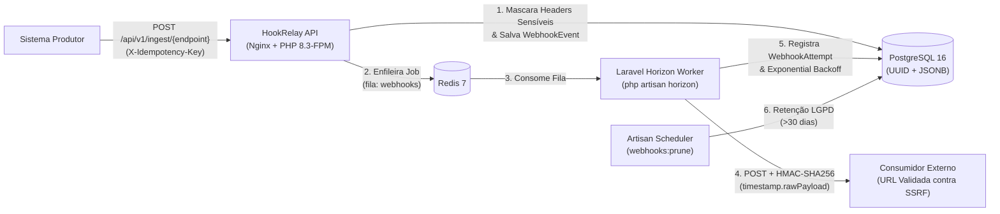
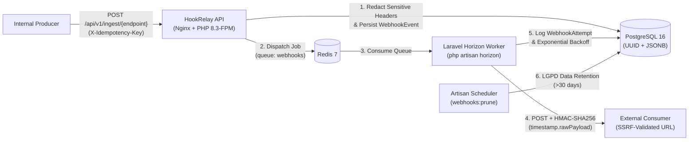

# HookRelay (`laravel-webhook-broker`)

> 🌐 **Idioma / Language:** [🇧🇷 Português (PT-BR)](#-português-pt-br) | [🇺🇸 English](#-english)

---

## 🇧🇷 Português (PT-BR)

O **HookRelay** é um **Gateway de Webhooks e Fila de Retentativas Assíncrona** resiliente e pronto para produção, construído com **PHP 8.3+**, **Laravel 11**, **PostgreSQL 16**, **Redis 7** e **Laravel Horizon**.

Projetado com **Clean Architecture**, **Tipagem Estrita (`declare(strict_types=1);`)** e práticas de **Privacy & Security by Design (LGPD/GDPR)**, o HookRelay desacopla microsserviços internos de consumidores HTTP externos instáveis, oferecendo ingestão idempotente, assinatura criptográfica anti-replay, retentativas com *exponential backoff*, proteção contra SSRF e auditoria completa de entregas.

---

### Arquitetura e Funcionalidades Principais



#### Destaques Técnicos
- **Ingestão Idempotente (`X-Idempotency-Key`):** Evita o disparo duplicado de webhooks por endpoint utilizando índice único composto `(endpoint_id, idempotency_key)` no PostgreSQL, retornando `200 OK` caso o evento já tenha sido recebido anteriormente.
- **Motor de Retentativas com Exponential Backoff:** Processado pelo **Laravel Horizon** sobre Redis (`[10s, 60s, 300s, 900s, 3600s]`), respeitando dinamicamente o `max_retries` e o `timeout_seconds` de cada endpoint.
- **Assinatura HMAC-SHA256 Resistente a Replay Attack:** Assina `"$timestamp.$rawPayload"` (padrão Stripe/Svix) com o `secret` do endpoint e envia os headers `X-Webhook-Signature` e `X-Webhook-Timestamp`.
- **Segurança & Privacidade by Design (LGPD):**
  - **Proteção contra SSRF (`SafeExternalUrl`):** Resolve o DNS do host e bloqueia endereços de loopback, redes privadas e metadados de cloud (`127.0.0.0/8`, `10.0.0.0/8`, `172.16.0.0/12`, `192.168.0.0/16`, `169.254.169.254`).
  - **Criptografia de Credenciais em Repouso:** O `secret` de cada endpoint utiliza o cast `'encrypted'` do Laravel no banco de dados e é exibido **apenas uma única vez** na resposta de criação (`201 Created`).
  - **Sanitização de Headers:** Mascara automaticamente headers sensíveis (`Authorization`, `Cookie`, `Set-Cookie`, `X-Api-Key`, `Proxy-Authorization`) com `[REDACTED]` antes de persistir na coluna `JSONB`.
  - **Política de Retenção Automática (`webhooks:prune`):** Comando Artisan agendado diariamente que expurga eventos e tentativas em cascata com mais de `WEBHOOK_RETENTION_DAYS` (padrão: `30` dias).
  - **Rate Limiting & Horizon Gate:** Rotas da API protegidas com `throttle:60,1` e painel do Horizon restrito em ambientes não-locais via `Gate::define('viewHorizon', ...)`.

---

### Stack Tecnológica

| Camada | Tecnologia |
| :--- | :--- |
| **Linguagem & Runtime** | PHP 8.3-FPM (Alpine) + Nginx 1.27 |
| **Framework** | Laravel 11 |
| **Banco de Dados** | PostgreSQL 16 (Chaves primárias `UUID` + colunas `JSONB`) |
| **Filas & Cache** | Redis 7 (Alpine) + Laravel Horizon |
| **Análise Estática** | Larastan / PHPStan (Nível 6) |
| **Testes Automatizados** | PestPHP 3 + `Http::fake()` & `Queue::fake()` |

---

### Como Executar com Docker

#### 1. Configurar o arquivo `.env`
```bash
cp .env.example .env
```

#### 2. Subir os containers
```bash
docker compose up -d --build
```

#### 3. Instalar dependências e rodar as migrations
```bash
docker compose exec app composer install
docker compose exec app php artisan key:generate
docker compose exec app php artisan migrate
```

Serviços disponíveis:
- **URL Base da API:** `http://localhost:8000/api/v1`
- **Painel do Laravel Horizon:** `http://localhost:8000/horizon`

---

### Exemplos de Uso da API (`curl`)

#### 1. Cadastrar um Endpoint de Destino
> **Atenção:** O campo `secret` é retornado **apenas uma vez** na criação (`201 Created`). Salve-o em local seguro para validar a assinatura HMAC no sistema consumidor.

```bash
curl -X POST http://localhost:8000/api/v1/endpoints \
  -H "Content-Type: application/json" \
  -H "Accept: application/json" \
  -d '{
    "name": "Billing Service Production",
    "url": "https://httpbin.org/post",
    "max_retries": 5,
    "timeout_seconds": 10
  }'
```

**Resposta (`201 Created`):**
```json
{
  "data": {
    "id": "0195a3e0-7c3a-72a1-8c11-4f8b92e1a001",
    "name": "Billing Service Production",
    "url": "https://httpbin.org/post",
    "secret": "whsec_9a8f7e6d5c4b3a2f1e0d9c8b7a6f5e4d3c2b1a0f9e8d7c6b",
    "is_active": true,
    "max_retries": 5,
    "timeout_seconds": 10,
    "created_at": "2026-11-17T15:00:00+00:00",
    "updated_at": "2026-11-17T15:00:00+00:00"
  }
}
```

#### 2. Ingerir um Evento de Webhook
```bash
curl -X POST http://localhost:8000/api/v1/ingest/0195a3e0-7c3a-72a1-8c11-4f8b92e1a001 \
  -H "Content-Type: application/json" \
  -H "Accept: application/json" \
  -H "X-Idempotency-Key: order_paid_98765" \
  -d '{
    "event_type": "order.paid",
    "payload": {
      "order_id": "ord_98765",
      "amount": 25990,
      "currency": "BRL"
    },
    "headers": {
      "X-Source-Service": "checkout-api"
    }
  }'
```

**Resposta (`202 Accepted` — ou `200 OK` caso a `X-Idempotency-Key` já tenha sido processada):**
```json
{
  "message": "Webhook event accepted and queued for delivery.",
  "event_id": "0195a3e1-2b4d-70f9-9a32-112233445566",
  "idempotent_replay": false,
  "data": {
    "id": "0195a3e1-2b4d-70f9-9a32-112233445566",
    "endpoint_id": "0195a3e0-7c3a-72a1-8c11-4f8b92e1a001",
    "idempotency_key": "order_paid_98765",
    "event_type": "order.paid",
    "status": "pending",
    "attempts_count": 0
  }
}
```

#### 3. Consultar Evento e Histórico de Tentativas (`webhook_attempts`)
```bash
curl -X GET http://localhost:8000/api/v1/events/0195a3e1-2b4d-70f9-9a32-112233445566 \
  -H "Accept: application/json"
```

#### 4. Replay Manual de um Evento
Reseta o `status` para `pending` e `attempts_count` para `0` (preservando o histórico anterior em `webhook_attempts`) e enfileira um novo disparo no Horizon:

```bash
curl -X POST http://localhost:8000/api/v1/events/0195a3e1-2b4d-70f9-9a32-112233445566/retry \
  -H "Accept: application/json"
```

---

### Como Validar a Assinatura no Consumidor (HMAC-SHA256)

Cada requisição disparada pelo HookRelay inclui os seguintes headers:
- `X-Webhook-Id`: UUID único do evento
- `X-Webhook-Event`: Tipo do evento (ex: `order.paid`)
- `X-Webhook-Timestamp`: Timestamp UNIX do momento da assinatura
- `X-Webhook-Signature`: Hash hexadecimal HMAC-SHA256 calculado sobre `"$timestamp.$rawPayload"`

#### Exemplo de Verificação em PHP
```php
$timestamp = $_SERVER['HTTP_X_WEBHOOK_TIMESTAMP'] ?? '';
$signature = $_SERVER['HTTP_X_WEBHOOK_SIGNATURE'] ?? '';
$rawPayload = file_get_contents('php://input');

// 1. Proteção contra Replay Attack (rejeita eventos com mais de 5 minutos)
if (abs(time() - (int) $timestamp) > 300) {
    http_response_code(401);
    exit('Timestamp fora da janela de tolerância.');
}

// 2. Calcula o HMAC-SHA256 esperado sobre "$timestamp.$rawPayload"
$expectedSignature = hash_hmac('sha256', "{$timestamp}.{$rawPayload}", $endpointSecret);

if (! hash_equals($expectedSignature, $signature)) {
    http_response_code(401);
    exit('Assinatura inválida.');
}

http_response_code(200);
```

---

### Qualidade de Código e Testes

Execute a suíte de testes **PestPHP** e a análise estática **Larastan (Nível 6)** dentro do container:

```bash
# Executar os testes de unidade e integração com PestPHP
docker compose exec -e APP_ENV=testing app ./vendor/bin/pest

# Executar análise estática PHPStan / Larastan (Nível 6)
docker compose exec app ./vendor/bin/phpstan analyse --memory-limit=512M

# Executar manualmente o comando de expurgo LGPD
docker compose exec app php artisan webhooks:prune --days=30
```

---
---

## 🇺🇸 English

**HookRelay** is a production-grade, resilient **Webhook Gateway and Asynchronous Retry Broker** built with **PHP 8.3+**, **Laravel 11**, **PostgreSQL 16**, **Redis 7**, and **Laravel Horizon**.

Designed with **Clean Architecture**, **Strict Typing (`declare(strict_types=1);`)**, and **Privacy & Security by Design (LGPD/GDPR)**, HookRelay decouples internal microservices from unreliable external HTTP consumers by providing idempotent ingestion, cryptographic signing, exponential backoff retries, SSRF protection, and full delivery auditability.

---

### Architecture & Core Capabilities



#### Key Features
- **Idempotent Ingestion (`X-Idempotency-Key`):** Prevents duplicate webhook dispatches per endpoint using a composite unique constraint `(endpoint_id, idempotency_key)` and returns `200 OK` on replays.
- **Exponential Backoff Engine:** Powered by **Laravel Horizon** and Redis queues (`[10s, 60s, 300s, 900s, 3600s]`), respecting each endpoint's configurable `max_retries` and `timeout_seconds`.
- **Replay-Resistant HMAC-SHA256 Signatures:** Signs `"$timestamp.$rawPayload"` (Stripe/Svix standard) using the endpoint's secret key and transmits `X-Webhook-Signature` alongside `X-Webhook-Timestamp`.
- **Security & Privacy by Design (LGPD / GDPR):**
  - **SSRF Protection (`SafeExternalUrl`):** Resolves host DNS records and blocks loopback, private network, and cloud metadata IP ranges (`127.0.0.0/8`, `10.0.0.0/8`, `172.16.0.0/12`, `192.168.0.0/16`, `169.254.169.254`).
  - **Encrypted Secrets at Rest:** Endpoint signing secrets use Laravel's `encrypted` cast in PostgreSQL and are displayed **only once** upon creation (`201 Created`).
  - **Header Sanitization:** Automatically redacts sensitive headers (`Authorization`, `Cookie`, `Set-Cookie`, `X-Api-Key`, `Proxy-Authorization`) to `[REDACTED]` before persisting to `JSONB`.
  - **Automated Data Retention (`webhooks:prune`):** Scheduled daily command that purges webhook events and cascaded delivery attempts older than `WEBHOOK_RETENTION_DAYS` (default `30` days).
  - **Rate Limiting & Horizon Gate:** API routes are protected with `throttle:60,1` and Horizon's dashboard is restricted in non-local environments via `Gate::define('viewHorizon', ...)`.

---

### Getting Started (Docker)

```bash
cp .env.example .env
docker compose up -d --build
docker compose exec app composer install
docker compose exec app php artisan key:generate
docker compose exec app php artisan migrate
```

- **API Base URL:** `http://localhost:8000/api/v1`
- **Horizon Dashboard:** `http://localhost:8000/horizon`

---

### Quality Assurance & Testing

```bash
# Run PestPHP feature & unit tests
docker compose exec -e APP_ENV=testing app ./vendor/bin/pest

# Run PHPStan / Larastan (Level 6)
docker compose exec app ./vendor/bin/phpstan analyse --memory-limit=512M

# Prune old webhook events manually (LGPD retention policy)
docker compose exec app php artisan webhooks:prune --days=30
```
